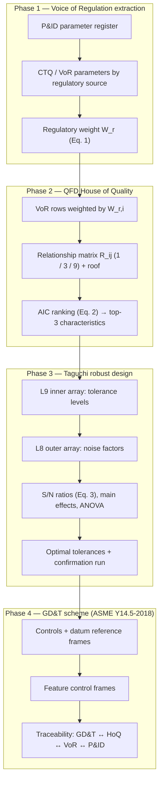

# VoR-QFD-Taguchi-GD&T Toolkit

An open-source framework for translating the regulatory and operational
requirements encoded in Piping and Instrumentation Diagrams (P&IDs) into
Geometric Dimensioning and Tolerancing (GD&T) schemes for process equipment —
by way of Voice of Regulation (VoR) extraction, Quality Function Deployment
(QFD), and Taguchi robust design.

Companion implementation for:

> **From Voice of Regulation to Robust Design Utilizing QFD and Taguchi
> Methods to Translate P&ID Requirements into GD&T Schemes for Process
> Equipment**
> Yeddula, V.R., Adurthy, D.B.R.R.K., Shaikh, S.S. — *Proceedings of the 5th
> International Conference on Computer Networks, Big Data and IoT
> (ICCBI-2026)*, pp. 492–499. ISBN 979-8-3315-6379-0.

```
python scripts/run_all.py
```

runs the full pipeline on the simulated demonstration dataset — House of Quality
ranking, Taguchi S/N table, ANOVA, GD&T scheme, traceability matrix, and
figures — and writes the paper's Tables 1–3, with Figures 2 and 5 plotted
from them, to `results/`.

> **Note:** Provided for academic and research experimentation purposes
> only. See [Disclaimer](#disclaimer) below.

## Relationship to the published paper

* This repository is an open-source implementation of the method described
  in the paper: its four phases, Equations (1)–(3), and the GD&T mapping,
  with unit tests and a runnable pipeline.
* The paper reports a case study of a high-pressure carbon steel pressure
  vessel and related piping system under ASME Section VIII Division 1. It
  publishes the study's summary results (Tables 1–3, Figures 2–5) but not the
  underlying inputs: the P&ID parameter ratings, the House of Quality
  relationship matrix, and the Taguchi measurements.
* The pipeline runs on a simulated demonstration dataset, so its numerical
  outputs illustrate the method and differ from the case-study values in the
  paper.
* The paper's own results are provided alongside by
  `scripts/07_published_values.py`: Tables 1–3, Figures 2 and 5 plotted from
  them, and a check that the optimum derived from Table 2 matches the optimum
  the paper reports.

## Verifying against the paper

| In the paper | In this repository | Status |
|---|---|---|
| Figure 1 — framework | `src/vor_gdt/`, one module per phase | Implemented |
| Equation (1) — regulatory criticality weight | `vor.regulatory_criticality_weight`, `vor.parameter_weights` | Implemented (per-parameter weights: see [`docs/methodology.md`](docs/methodology.md)) |
| Equation (2) — absolute importance (AIC) | `hoq.absolute_importance` | Implemented |
| Equation (3) — S/N ratio, nominal-the-best | `taguchi.sn_nominal_the_best` | Implemented as ȳ²/s², the form shown in the paper's Figure 1 |
| L9 / L18 orthogonal arrays, ANOVA | `orthogonal_arrays`, `taguchi.anova` | Implemented; orthogonality tested |
| GD&T scheme (ASME Y14.5-2018), datums, traceability | `gdt`, `traceability` | Implemented |
| Table 1 | `results/tables/table1_hoq_aic_rankings_as_reported.*` | Included; ranks checked against the AIC order |
| Table 2 | `results/tables/table2_taguchi_l9_sn_ratios_as_reported.*`, `table2_main_effects_as_reported.*` | Included; design checked to be the standard L9; its main effects give the reported optimum (±0.5 mm, ±0.3 mm, 0.05 mm) |
| Table 3 | `results/tables/table3_benchmarking_as_reported.*` | Included |
| Figure 2 | `results/figures/figure2_sn_ratio_trends_as_reported.png` | Plotted from Table 2 |
| Figure 5 | `results/figures/figure5_weighted_aic_radar_as_reported.png` | Plotted from Table 1 |
| Figures 3 and 4 | — | Not included: apart from the values quoted in the text, their data are given graphically |
| — (not in the paper) | `robust_design`: additive S/N prediction and confirmation run; `taguchi`: smaller-the-better and larger-the-better S/N | Added by the toolkit |

Files with the `_as_reported` suffix hold the paper's values; all other files
are generated from the demonstration dataset.

## Overview

Process-equipment drawings are often specified without a traceable link back
to the P&ID requirements that motivate them. The framework closes that gap in
four stages, each feeding the next:

* **Phase 1 — Voice of Regulation (VoR) extraction.** Critical-to-quality
  parameters are selected from the P&ID data by regulatory source (ASME
  Section VIII, OSHA PSM, project process datasheets) and weighted by severity
  and compliance criticality (Eq. 1).
* **Phase 2 — QFD House of Quality.** VoR parameters are related to
  engineering characteristics on a 1/3/9 scale; the weighted absolute
  importance (AIC, Eq. 2) ranks the characteristics, and the roof flags
  conflicting pairs.
* **Phase 3 — Taguchi robust design.** The highest-AIC characteristics become
  control factors in an L9 (or L18) inner array, crossed with an outer array
  of noise factors. S/N ratios (Eq. 3), main effects, and ANOVA identify the
  most robust tolerance levels.
* **Phase 4 — GD&T scheme and traceability.** Each characteristic is mapped
  to an ASME Y14.5-2018 control with a datum reference frame, and every
  callout is traced back to its VoR parameters, P&ID tags, and regulatory
  sources.

## Components

| Component | Description |
|---|---|
| **Dataset** | A fictional P&ID parameter register (15 items, 11 of them VoR parameters), an 11 × 6 House of Quality relationship matrix with roof correlations, and 216 seeded Monte Carlo measurements (L9 inner array × L8 outer array × 3 replicates). |
| **VoR extraction** | Register validation, regulatory-source filtering and classification, and the Eq. (1) regulatory criticality weight. |
| **House of Quality** | Eq. (2) weighted AIC, relationship sums, ranking, top-k selection for optimization, and roof-conflict detection. |
| **Taguchi robust design** | L4, L8, L9 and L18 orthogonal arrays; nominal-the-best (Eq. 3), smaller-the-better and larger-the-better S/N ratios; main effects, optimum selection, additive S/N prediction, confirmation run, and ANOVA with percentage contributions. |
| **GD&T scheme** | ASME Y14.5-2018 control catalogue with datum rules, feature control frame rendering, and position-zone conversion. |
| **Traceability** | Callout ↔ characteristic ↔ VoR parameter ↔ P&ID tag matrix with two-way coverage checks. |
| **Paper results** | The paper's Tables 1–3, Figures 2 and 5 plotted from them, and consistency checks on Table 2 (L9 design, main-effects optimum). |

Every dependency is open source under a permissive licence: `numpy`,
`pandas`, `scipy`, `matplotlib`.

## Architecture



See [`docs/methodology.md`](docs/methodology.md) for the equations and the
implementation choices behind each component.

## Repository layout

```
vor-qfd-taguchi-gdt-toolkit/
├── src/vor_gdt/                  # the package
│   ├── config.py                 # paths, demonstration register, HoQ matrix, factor levels, simulation model
│   ├── vor.py                    # Phase 1: VoR extraction + regulatory weight (Eq. 1)
│   ├── hoq.py                    # Phase 2: House of Quality, AIC (Eq. 2), roof conflicts
│   ├── orthogonal_arrays.py      # L4 / L8 / L9 / L18 arrays + orthogonality check
│   ├── taguchi.py                # S/N ratios (Eq. 3), main effects, ANOVA
│   ├── robust_design.py          # Phase 3 orchestration: optimum, prediction, confirmation
│   ├── gdt.py                    # Phase 4: ASME Y14.5-2018 controls, feature control frames
│   ├── traceability.py           # callout <-> HoQ <-> VoR <-> P&ID matrix + coverage
│   ├── data_generation.py        # simulated demonstration dataset
│   ├── published.py              # the paper's Tables 1-3 + consistency checks
│   ├── figures.py                # demonstration figures + the paper's Figures 2 and 5
│   └── reporting.py              # CSV / Markdown / JSON writers
├── scripts/                      # numbered, runnable pipeline steps + run_all.py
├── data/raw/                     # register, HoQ matrix and roof, Taguchi measurements (CSV)
├── data/processed/               # intermediate outputs of each phase
├── results/tables/               # demonstration outputs; *_as_reported = the paper's Tables 1-3
├── results/figures/              # demonstration figures; *_as_reported = the paper's Figures 2 and 5
├── tests/                        # unit tests for every module
├── docs/methodology.md           # equations and implementation choices
├── pyproject.toml                # packaging metadata (pip install -e .)
├── pytest.ini                    # test discovery config
└── .github/workflows/ci.yml      # CI: tests + full pipeline on every push
```

## Quick start

Requires Python 3.10 or newer.

```bash
git clone https://github.com/yeddula-research/vor-qfd-taguchi-gdt-toolkit.git
cd vor-qfd-taguchi-gdt-toolkit
python -m venv .venv && source .venv/bin/activate      # optional but recommended
pip install -r requirements.txt

python scripts/run_all.py
```

### Run individual stages

```bash
python scripts/01_generate_dataset.py          # -> data/raw/ (register, HoQ matrix, measurements)
python scripts/02_extract_vor.py               # -> VoR parameters and W_r (Eq. 1)
python scripts/03_build_house_of_quality.py    # -> Table 1: AIC ranking (Eq. 2), roof conflicts
python scripts/04_run_taguchi.py               # -> Table 2: S/N ratios (Eq. 3), ANOVA, confirmation run
python scripts/05_formulate_gdt_scheme.py      # -> GD&T scheme, traceability matrix and coverage
python scripts/06_generate_figures_tables.py   # -> demonstration figures (S/N trends, ANOVA, AIC, main effects)
python scripts/07_published_values.py          # -> the paper's Tables 1-3, Figures 2 and 5, consistency checks
```

### Run the tests

```bash
pip install -r requirements-dev.txt
pytest -v
```

## Results

Running `python scripts/run_all.py` regenerates every table below from the
bundled demonstration dataset and writes them to `results/tables/`.

**Table 1 — House of Quality: AIC rankings of engineering characteristics**
(this run's demonstration-dataset output)

| Engineering characteristic | VoR parameters (strong relationship) | Relationship sum | Wr-weighted AIC | Share of total AIC (%) | Priority rank |
|---|---|---|---|---|---|
| Shell wall thickness tolerance | Design pressure; Corrosion allowance; Hydrostatic test pressure | 38 | 29.93 | 30.63 | 1 |
| Nozzle bore positional tolerance | Design flow rate; Instrument tap location; Safety interlock clearance (high-high level trip) | 34 | 21.16 | 21.65 | 2 |
| Flange face flatness | Gasket seating and pressure boundary integrity | 20 | 15.36 | 15.72 | 3 |
| Shell out-of-roundness | External pressure rating | 18 | 13.67 | 13.99 | 4 |
| Weld joint perpendicularity | Radiographic inspection access and weld alignment | 15 | 10.00 | 10.23 | 5 |
| Surface roughness (Ra) | Service corrosion rate and internal coating | 16 | 7.60 | 7.78 | 6 |

The top three characteristics, carried into Taguchi optimization, account for
68.0% of the total AIC. The aggregate regulatory criticality weight of the 11
extracted VoR parameters is W_r = 7.400 (Eq. 1).

**Table 2 — Taguchi L9 inner array: S/N ratios for the top three characteristics**
(this run's demonstration-dataset output)

| Run | Wall thickness tolerance | Bore position tolerance | Flange face flatness tolerance | S/N wall (dB) | S/N bore (dB) | S/N flatness (dB) |
|---|---|---|---|---|---|---|
| Run 1 | ±0.5 mm | ±0.3 mm | 0.05 mm | 39.39 | 17.30 | 29.16 |
| Run 2 | ±0.5 mm | ±0.5 mm | 0.10 mm | 39.63 | 10.44 | 24.38 |
| Run 3 | ±0.5 mm | ±0.8 mm | 0.15 mm | 38.07 | 8.37 | 21.25 |
| Run 4 | ±0.8 mm | ±0.3 mm | 0.10 mm | 35.07 | 14.36 | 23.80 |
| Run 5 | ±0.8 mm | ±0.5 mm | 0.15 mm | 35.60 | 12.97 | 19.93 |
| Run 6 | ±0.8 mm | ±0.8 mm | 0.05 mm | 35.64 | 9.00 | 29.11 |
| Run 7 | ±1.2 mm | ±0.3 mm | 0.15 mm | 31.15 | 15.39 | 20.26 |
| Run 8 | ±1.2 mm | ±0.5 mm | 0.05 mm | 30.88 | 12.23 | 28.56 |
| Run 9 | ±1.2 mm | ±0.8 mm | 0.10 mm | 32.89 | 7.34 | 24.75 |
| Optimum - predicted | ±0.5 mm | ±0.3 mm | 0.05 mm | 38.80 | 16.69 | 29.13 |
| Optimum - confirmation run | ±0.5 mm | ±0.3 mm | 0.05 mm | 38.65 | 16.75 | 29.08 |

The main-effects optimum is the tightest level of each tolerance. In the
ANOVA of each characteristic's S/N ratio, that characteristic's own tolerance
factor accounts for 95.4% (wall thickness), 90.0% (nozzle bore position) and
98.5% (flange face flatness) of the variation. The wall-thickness S/N uses
Eq. (3) (nominal-the-best); bore position error and flatness deviation, whose
ideal value is zero, use the smaller-the-better form (see
[`docs/methodology.md`](docs/methodology.md)).

**GD&T scheme per ASME Y14.5-2018** (this run's demonstration-dataset output)

| Priority rank | Engineering characteristic | Callout | Tolerance source |
|---|---|---|---|
| 1 | Shell wall thickness tolerance | 16.0 ±0.50 mm | Taguchi optimum |
| 2 | Nozzle bore positional tolerance | ⌖ \| ⌀0.60 \| A \| B \| C | Taguchi optimum |
| 3 | Flange face flatness | ⏥ \| 0.05 | Taguchi optimum |
| 4 | Shell out-of-roundness | ○ \| 2.00 | Default (not optimized) |
| 5 | Weld joint perpendicularity | ⟂ \| 0.50 \| A | Default (not optimized) |
| 6 | Surface roughness (Ra) | Ra 3.2 µm max | Default (not optimized) |

Datums: A = shell axis, B = reference tangent line, C = 0° orientation line.
The traceability matrix (`results/tables/traceability_matrix.*`) holds 21
callout-to-VoR links; all 11 VoR parameters reach at least one callout, and
all 6 callouts trace to at least one VoR parameter.

The tables above are generated fresh from the seeded demonstration dataset
each time the pipeline runs. Because they come from the demonstration
dataset (see [Dataset](#dataset) below), their values differ from the case-study
values in the paper's Tables 1 and 2.

**Table 3 — Quantitative benchmarking against conventional design methods**
(from the paper)

| Design Approach | Rework Rate (%) | Dimensional Non-Conformance (%) | Design Robustness |
|---|---|---|---|
| Conventional Design Method | 31 | 28 | Moderate |
| QFD-Based Design | 18 | 15 | Improved |
| Proposed VoR–QFD–Taguchi–GD&T Framework | 9 | 6 | High |

Table 3, and the before/after rework comparison in the paper's Figure 4, are
outcomes of the paper's case study rather than outputs of the method, so
Table 3 is taken from the paper; `scripts/07_published_values.py` writes it on
every run, together with the paper's Tables 1 and 2 (see
[Verifying against the paper](#verifying-against-the-paper)).

Figures written to `results/figures/` on every run, from the demonstration
dataset:

* `figure2_sn_ratio_trends.png` — S/N ratio of each characteristic across the nine L9 runs
* `figure3_anova_contributions.png` — ANOVA percentage contributions to each characteristic's S/N
* `figure5_weighted_aic_scores.png` — weighted AIC of all six engineering characteristics
* `main_effects_sn.png` — mean S/N at each level of each control factor

and from the paper's Tables 1 and 2:

* `figure2_sn_ratio_trends_as_reported.png` — the paper's Figure 2, from its Table 2
* `figure5_weighted_aic_radar_as_reported.png` — the paper's Figure 5, from its Table 1

## Dataset

The demonstration dataset is simulated: a fictional P&ID parameter register, House of Quality relationship matrix, and seeded Monte Carlo measurements for a fictional pressure vessel (V-101), generated by scripts/01_generate_dataset.py; it is not the case-study data reported in the paper.

The paper's case study concerns a high-pressure carbon steel pressure vessel
and related piping system under ASME Section VIII Division 1 requirements,
with 11 VoR parameters derived from the governing P&ID. The paper reports
summary results but not the underlying register, relationship matrix, or
measurements. The demonstration dataset mirrors the case study's structure
(11 VoR parameters, six engineering characteristics, three optimized with an
L9 array, and the same tolerance levels as the paper's Table 2), so that
anyone can run the complete pipeline end-to-end; its values, relationships,
and measurements are the toolkit's own. The measurement-simulation model and
its coefficients are documented in
[`docs/methodology.md`](docs/methodology.md).

## Extending this toolkit

* **Plug in your own P&ID data**: replace `data/raw/pid_parameter_register.csv`
  and `data/raw/hoq_relationship_matrix.csv` with your own register and
  relationship scores in the same schema, and re-run from
  `scripts/02_extract_vor.py` onward.
* **Use measured data**: replace `data/raw/taguchi_measurements.csv` with real
  inner × outer array measurements in the same long format (one row per run,
  noise condition, and replicate) and re-run from `scripts/04_run_taguchi.py`.
* **More control factors**: add entries to `config.CONTROL_FACTORS`; with five
  to seven three-level factors the pipeline switches to an L18 inner array.
* **Different selection or tracing rules**: `config.TOP_K_FOR_OPTIMIZATION`
  and `config.TRACE_RELATIONSHIP_THRESHOLD` are the only place these live.
* **Tolerance cost**: the S/N criterion favours tighter tolerances; a
  cost-of-tolerance or quality-loss term can be added alongside
  `robust_design.analyze_experiment` to trade robustness against cost.

## License

MIT — see [`LICENSE`](LICENSE). Free to use, modify, and redistribute,
including commercially, with attribution.

## Disclaimer

This repository — the code, dataset, and results — is provided for
**academic and research experimentation purposes only**. It has not been
tested, validated, or certified for use in any production, safety-critical,
regulatory-compliance, pressure-equipment design, or commercial engineering
application, and it is not a substitute for the applicable codes and
standards or for review by a qualified engineer. Use it at your own risk.

The authors and copyright holders make no warranties about this software's
completeness, reliability, or accuracy, and accept no liability for any
damages — direct, indirect, incidental, or consequential — arising from its
use. See [`LICENSE`](LICENSE) for the full disclaimer.

## Citation

See [`CITATION.cff`](CITATION.cff).

```bibtex
@inproceedings{yeddula2026voiceofregulation,
  title     = {From Voice of Regulation to Robust Design Utilizing QFD and Taguchi Methods to Translate P\&ID Requirements into GD\&T Schemes for Process Equipment},
  author    = {Yeddula, Vijayakumar Reddy and Adurthy, Durga Bhaskara Raghava Rama Kishor and Shaikh, Shahnawaz Shakil},
  booktitle = {Proceedings of the 5th International Conference on Computer Networks, Big Data and IoT (ICCBI-2026)},
  pages     = {492--499},
  year      = {2026},
  isbn      = {979-8-3315-6379-0}
}
```

## Contributing

Issues and pull requests are welcome — real P&ID-derived registers,
additional S/N forms or inner arrays, tolerance-cost models, and GD&T mapping
rules for other equipment types are all valuable contributions.
